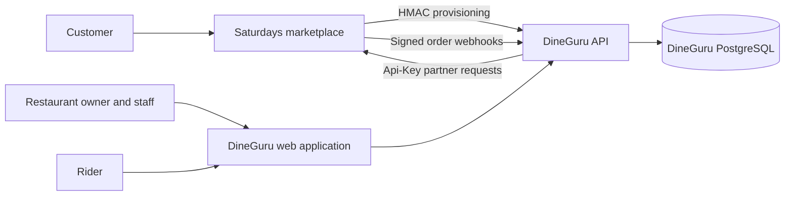
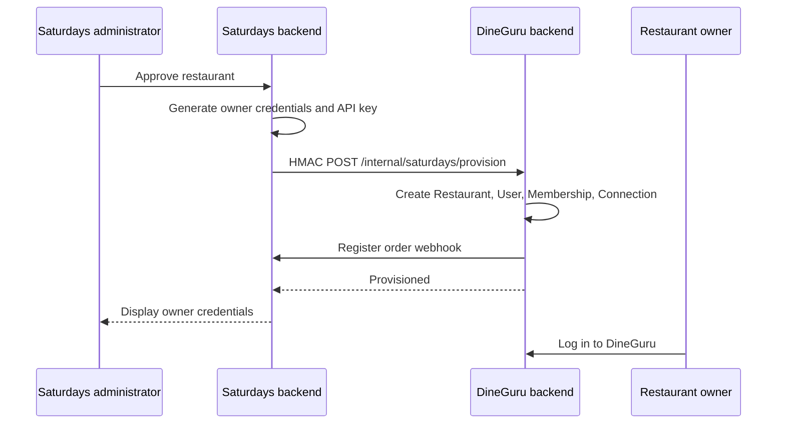
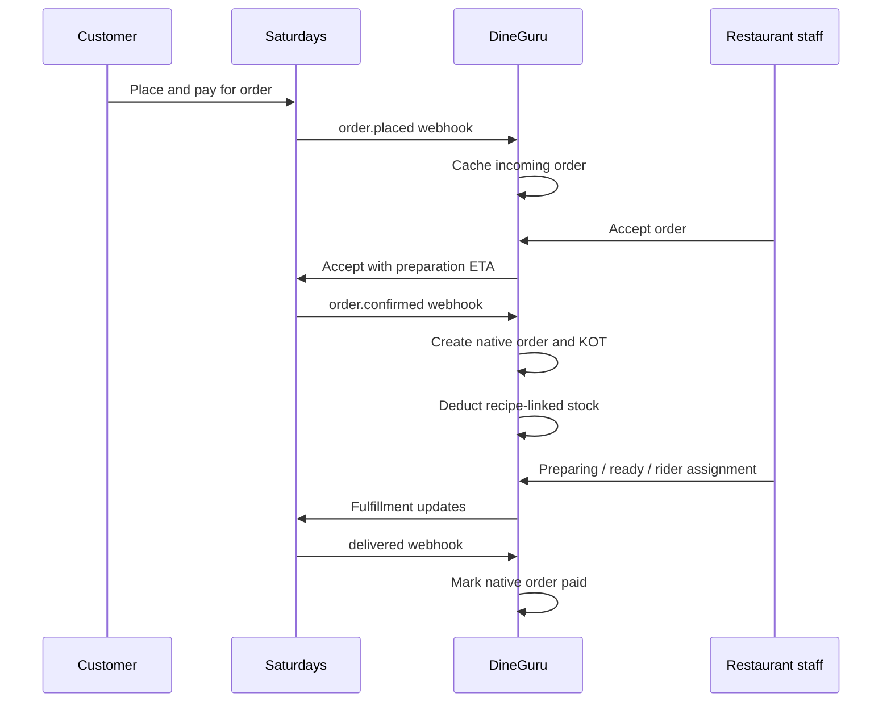

# DineGuru Architecture and Saturdays Integration

## Executive summary

DineGuru is a restaurant operations platform. Saturdays is the customer-facing
marketplace.

DineGuru owns restaurant-side operations such as point of sale, kitchen tickets,
menu management, inventory, recipes, procurement, restaurant analytics, staff,
riders, and order fulfillment. Saturdays owns customer discovery, cart, checkout,
online payments, customer order tracking, restaurant marketplace onboarding, and
the partner API used by DineGuru.

The systems communicate through:

- HMAC-signed restaurant provisioning requests from Saturdays to DineGuru.
- Per-restaurant API keys used by DineGuru when calling Saturdays.
- Per-connection HMAC-signed order webhooks from Saturdays to DineGuru.
- Reconciliation requests that recover orders missed by webhooks.
- External menu-item identifiers that link marketplace lines to DineGuru items.

The current `saturdays_v2` FastAPI project does not yet implement the
`/api/dineguru/v1` partner API or signed provisioning bridge expected by the
DineGuru repository. An integration adapter is therefore required before the two
applications can operate together.

## Repository examined

The audited DineGuru repository is organized as:

```text
dineguru/
├── backend/                 FastAPI and PostgreSQL application
│   ├── app/
│   ├── alembic/
│   ├── tests/
│   ├── Dockerfile
│   └── docker-compose.yml
├── frontend/                React and Vite single-page application
├── Architecture.md
├── LOCAL_SETUP.md
├── DEPLOYMENT.md
└── render.yaml
```

### Backend stack

- Python 3.11 or later
- FastAPI
- SQLAlchemy 2 async ORM
- PostgreSQL through `asyncpg`
- Alembic migrations
- Pydantic v2
- Self-hosted bcrypt and JWT authentication
- `httpx` for Saturdays server-to-server communication
- Structured logging through `structlog`

### Frontend stack

- React 19
- TypeScript
- Vite 8
- React Router 8
- Tailwind CSS 4
- Radix UI primitives
- Recharts
- Responsive web rider interface

There is no React Native, Flutter, Expo, or other native mobile application in
this repository.

## Product responsibility boundary

| Capability | System of record | Notes |
|---|---|---|
| Customer discovery | Saturdays | Restaurants, menus, offers, and search shown to customers |
| Customer cart and checkout | Saturdays | DineGuru has no customer cart service |
| Online customer payment | Saturdays | Razorpay and customer payment state belong to Saturdays |
| Customer order tracking | Saturdays | Includes status, rider visibility, and handover OTP |
| Restaurant marketplace approval | Saturdays | Approval triggers DineGuru provisioning |
| Restaurant POS | DineGuru | In-store orders and billing |
| Kitchen operations | DineGuru | KOT creation and preparation flow |
| Menu authoring | DineGuru | Intended operational source of truth |
| Marketplace menu publication | DineGuru to Saturdays | Prices include platform commission and configured GST |
| Ingredients and inventory | DineGuru | Recipe-linked stock is deducted when a KOT is fired |
| Recipes and costing | DineGuru | Ingredient usage and menu margin calculations |
| Vendors and procurement | DineGuru | Vendor offers and purchase orders |
| Restaurant staff | DineGuru | Owners create staff credentials |
| Delivery riders | DineGuru | Owners assign riders to Saturdays orders |
| Restaurant analytics | DineGuru | Revenue, menu, staff, stock, and portfolio analytics |
| Order fulfillment | DineGuru UI with Saturdays API | DineGuru sends state changes back to Saturdays |
| COD collection | Saturdays payment infrastructure | Initiated by the DineGuru rider interface |

## High-level architecture



## DineGuru backend modules

### Identity and access

Location: `backend/app/identity`

Implemented capabilities:

- Login
- Access JWT creation and validation
- Opaque refresh tokens stored as hashes
- Refresh-token rotation
- Refresh-token reuse detection
- Logout and token revocation
- Password changes and password-reset confirmation
- Multi-restaurant memberships

There is no public self-registration. Production owner accounts are expected to
be provisioned by Saturdays.

### Restaurant management

Location: `backend/app/restaurants`

Implemented capabilities:

- Restaurant profile and settings
- GST and FSSAI configuration
- Owner-managed staff accounts
- Owner-managed rider accounts
- Multi-restaurant owner access
- Pending, active, and rejected restaurant states

DineGuru uses `Restaurant` as its tenant boundary. One restaurant effectively
represents one operating outlet.

### Menu

Location: `backend/app/menu`

Implemented capabilities:

- Menu-item CRUD
- Categories
- Availability toggles
- Recipe associations
- Recipe-derived price synchronization
- Soft deletion
- Saturdays menu publication
- One-time import from Saturdays

DineGuru is intended to become the menu authoring source of truth after initial
setup.

### Ingredients and inventory

Location: `backend/app/ingredients`

Implemented capabilities:

- Ingredient CRUD
- Current stock
- Reorder thresholds
- Individual and batch stock adjustments
- Ingredient price history
- Deletion-impact previews

Recipe-linked stock is deducted when items are fired to the kitchen.

### POS, orders, KOTs, and billing

Location: `backend/app/orders`

DineGuru does not have a separate cart service. A POS cart is represented by an
open order containing draft order-item rows.

Typical POS lifecycle:

1. Create an open order.
2. Add or update draft lines.
3. Fire lines to a KOT.
4. Deduct recipe-linked ingredient stock.
5. Apply optional discount or extra charge.
6. Checkout using CASH, UPI, or SPLIT.
7. Mark the order paid and retain it in bill history.

Order totals are calculated server-side and important order values are
snapshotted.

### Recipes and costing

Location: `backend/app/recipes`

Implemented capabilities:

- Recipe CRUD
- Ingredient quantities
- Preparation steps
- Current recipe cost
- Cost snapshots
- Menu margin calculations

### Procurement

Location: `backend/app/procurement`

Implemented capabilities:

- Vendor CRUD
- Ingredient vendor offers
- Current vendor-price selection
- Purchase-order creation and lifecycle
- Purchase-order receiving
- Ingredient stock credit when a purchase order is received

Exclusive vendor contracts remain a placeholder rather than a completed backend
feature.

### Analytics

Location: `backend/app/dashboard`

Implemented reports include:

- Overview
- Revenue trend
- Category breakdown
- Payment-method breakdown
- Cancellations
- Staff performance
- Menu-item margin
- Reorder alerts
- Peak hours
- Table turnover
- Slow-moving inventory
- Discount impact
- Ingredient-price volatility
- Multi-restaurant portfolio overview

Analytics subscription-tier enforcement is currently a frontend stub. It does
not represent an implemented billing product.

### Saturdays integration

Location: `backend/app/saturdays`

This module is the primary cross-service adapter. It contains:

- Encrypted Saturdays connection records
- A server-to-server Saturdays HTTP client
- HMAC-signed provisioning endpoints
- Marketplace restaurant and operating-hours controls
- Menu import and publication
- Incoming-order cache
- Signed order-webhook receiver
- Webhook idempotency
- Reconciliation backstop
- Native DineGuru order ingestion
- Rider assignment and delivery controls

### Rider operations

Location: `backend/app/rider`

Implemented rider flow:

1. View assigned deliveries.
2. Mark pickup.
3. View customer delivery information.
4. Open COD collection through a Saturdays-provided Razorpay QR.
5. Verify the customer handover OTP.
6. Complete delivery.

## Roles and authorization

### Restaurant roles

| Role | Purpose |
|---|---|
| `owner` | Full restaurant setup, finance, menu, recipe, procurement, analytics, staff, and rider control |
| `staff` | POS, order processing, availability, inventory, bills, and allowed Saturdays order actions |
| `rider` | Assigned-delivery interface only |

### Super administrator

DineGuru super administrators are controlled through the
`SUPER_ADMIN_EMAILS` environment allowlist. The admin frontend currently supports
restaurant listing and onboarding approval.

### Tenant isolation

The frontend sends `X-Restaurant-Id` for the selected restaurant. The backend
does not trust this value directly. It checks that the authenticated user has an
active membership for the requested restaurant.

All business queries are expected to include the resolved restaurant ID.

## DineGuru frontend

The repository contains one React SPA with three operating modes.

### Restaurant owner and staff workspace

Primary routes:

| Route | Purpose |
|---|---|
| `/` | Restaurant overview |
| `/pos` | POS, KOT, and live order handling |
| `/inventory` | Ingredients and stock |
| `/menu-availability` | Menu availability and Saturdays menu import |
| `/recipes` | Recipe and cost management |
| `/procurement` | Vendors and purchase orders |
| `/bills` | Paid and historical orders |
| `/saturdays` | Marketplace configuration and incoming Saturdays orders |
| `/settings` | Restaurant, GST, FSSAI, menu, staff, rider, and bill settings |
| `/analytics/*` | Restaurant and portfolio analytics |

### Rider workspace

The rider interface is mobile-first responsive web. It is selected directly by
the authenticated `rider` role rather than by a public route.

### Super-admin workspace

Implemented routes:

- `/admin/login`
- `/admin/restaurants`
- `/admin/onboarding`

Earlier admin dashboards, commissions, feature flags, and Saturdays admin
screens were removed because they depended on mock data.

## Restaurant onboarding flow

The intended production flow begins in Saturdays:



Provisioning is idempotent using the Saturdays restaurant public ID. Repeating
the operation updates the existing account rather than creating duplicates.

## Menu synchronization

### DineGuru to Saturdays

DineGuru publishes:

- External DineGuru item ID
- Name
- Category
- Availability
- Marketplace price

The published price includes:

- Base DineGuru menu price
- Fixed Saturdays platform commission
- Restaurant-configured GST percentage

### Saturdays to DineGuru

A one-time menu import exists for restaurants that already configured their menu
on Saturdays. After import, DineGuru becomes the operational authoring source.

Saturdays rows are linked back to DineGuru item IDs. This external-ID mapping is
essential for turning marketplace order lines into native DineGuru order lines,
KOTs, and inventory deductions.

## Saturdays order flow



Webhook delivery IDs are persisted for idempotency. If a webhook is missed,
reconciliation asks Saturdays for current orders and backfills DineGuru state.

## Expected cross-service API

### Saturdays calls DineGuru

| Endpoint | Purpose |
|---|---|
| `POST /api/v1/internal/saturdays/ping` | Verify shared-secret configuration |
| `POST /api/v1/internal/saturdays/provision` | Create or resynchronize a restaurant and owner |
| `POST /api/v1/internal/saturdays/set-active` | Suspend or restore owner access |
| `POST /api/v1/internal/saturdays/password-reset` | Create an owner password-reset token |
| `POST /api/v1/saturdays/webhook/{token}` | Deliver signed order events |

### DineGuru calls Saturdays

DineGuru's `SaturdaysClient` expects the following partner API prefix:

```text
/api/dineguru/v1
```

Expected operations include:

| Endpoint | Purpose |
|---|---|
| `GET/PATCH /restaurant/` | Marketplace restaurant profile |
| `GET/PUT /restaurant/hours/` | Marketplace operating hours |
| `GET /menu/` | Read published menu |
| `PATCH /menu/{public_id}/` | Update marketplace menu row |
| `POST /menu/sync/` | Publish the DineGuru menu |
| `POST /menu/link-external-ids/` | Store DineGuru menu-item mappings |
| `GET /orders/` | Read active marketplace orders |
| `GET /orders/{public_id}/` | Read one order |
| `POST /orders/{public_id}/accept/` | Accept with preparation ETA |
| `POST /orders/{public_id}/reject/` | Reject an order |
| `PATCH /orders/{public_id}/status/` | Advance fulfillment |
| `PATCH /orders/{public_id}/delivery/` | Update rider and delivery state |
| `POST /orders/{public_id}/collection/` | Create a COD payment QR |
| `GET /orders/{public_id}/collection/` | Read COD payment status |
| `POST /orders/{public_id}/verify-otp/` | Verify customer handover OTP |
| `POST /orders/{public_id}/regenerate-otp/` | Regenerate handover OTP |
| `POST /webhook/` | Register DineGuru's order webhook |

Calls use:

```http
Authorization: Api-Key <per-restaurant-key>
```

## Required environment configuration

### DineGuru backend

- `DATABASE_URL`
- `SECRET_KEY`
- `CORS_ORIGINS`
- `SATURDAYS_PROVISION_SHARED_SECRET`
- `SATURDAYS_WEBHOOK_BASE_URL`
- `SUPER_ADMIN_EMAILS`

`SATURDAYS_WEBHOOK_BASE_URL` is DineGuru's own externally reachable API address,
despite the variable name sounding like a Saturdays URL.

### DineGuru frontend

- `VITE_API_URL`

Local paired development commonly uses:

- Saturdays API: port `8000`
- DineGuru API: port `8001`
- Saturdays frontend: port `5173`
- DineGuru frontend: port `5174`
- DineGuru PostgreSQL: port `5431`

## Current incompatibility with `saturdays_v2`

The audited DineGuru repository expects an older or separate Saturdays partner
implementation.

The current `saturdays_v2` FastAPI workspace does not contain:

- The `/api/dineguru/v1` partner API.
- An HMAC-signed DineGuru provisioning client.
- DineGuru webhook registration support.
- A Branch-to-DineGuru-Restaurant mapping.
- Translation between the two role models.

### Model differences

| Saturdays v2 | DineGuru |
|---|---|
| Merchant | Restaurant owner or group |
| Brand | No direct entity |
| Branch | Restaurant tenant |
| Kitchen | KOT and preparation workflow |
| MerchantOwner | `owner` |
| BranchManager / KitchenStaff | `staff` |
| Customer | Not present |
| Customer checkout | Not present |
| PlatformAdmin | Email-allowlisted super administrator |

The applications should not share ORM models or databases. Integration should
use explicit partner APIs and stable external identifiers.

## Recommended integration design

1. Treat each approved Saturdays Branch as one DineGuru Restaurant.
2. Add a mapping table in Saturdays containing:
   - Saturdays branch ID
   - DineGuru restaurant ID
   - Provisioning status
   - Last successful synchronization time
   - Last integration error
3. Generate a scoped partner API key for each branch.
4. Add the `/api/dineguru/v1` router to Saturdays.
5. Add signed provisioning calls when a branch becomes operational.
6. Add DineGuru webhook registration and event delivery.
7. Translate Saturdays roles to DineGuru roles at the integration boundary.
8. Use DineGuru external menu-item IDs for marketplace menu rows.
9. Emit order lifecycle webhooks with stable event IDs.
10. Add reconciliation and retry jobs on both sides.
11. Keep customer payment secrets and provider webhooks in Saturdays.
12. Keep POS, recipe, inventory, procurement, and rider operations in DineGuru.

Avoid duplicating DineGuru's restaurant operations modules inside Saturdays.
Saturdays may retain operational summaries for platform support, but DineGuru
should remain the source of truth for POS, KOT, recipes, inventory, procurement,
and restaurant fulfillment.

## Known gaps and risks

### DineGuru

- No queue or background worker.
- No WebSocket event layer; the frontend relies on polling.
- Manual reconciliation is required as a webhook backstop.
- Some owner checks use the global user role instead of the active membership
  role.
- Super-admin authorization is based on an environment email allowlist.
- No backend rate limiting.
- No frontend automated test suite was found.
- No backend CI workflow was found.
- No production metrics or error-monitoring integration was found.
- `SECRET_KEY` rotation also invalidates encrypted Saturdays API keys.
- Unmapped marketplace menu lines are skipped during native order ingestion.
- Floor plans and tables are deferred.
- Vendor contracts are placeholders.
- Analytics subscription tiers are not enforced.

### Documentation

`Architecture.md` contains some stale references to Firebase authentication.
Current code uses self-hosted JWT authentication and PostgreSQL-backed refresh
tokens.

## Deployment

The documented production layout is:

- DineGuru frontend: Firebase Hosting at `dineguru.in`
- DineGuru API: Render at `api.dineguru.in`
- DineGuru database: Neon PostgreSQL

The backend container runs Alembic migrations before starting Uvicorn.

## Conclusion

DineGuru should be treated as a separate restaurant operations product connected
to Saturdays through a versioned partner API.

The clean boundary is:

```text
Saturdays
  Customer acquisition, marketplace, checkout, payment, tracking

             versioned API + signed events

DineGuru
  Restaurant POS, kitchen, menu, inventory, recipes, procurement, analytics,
  fulfillment, and riders
```

The next engineering step is to implement the missing integration adapter in
`saturdays_v2`, not to merge the two databases or duplicate DineGuru's domain
models.
